# Classical-ML vs. Modern Deblurring under One Protocol

### Results for the M1 (data-only) and M2 (physics-aware) Arms

**Surya Manoj Pentakota (2026701036)** · **Kevin Paul Reddy Janagari (2026900006)** · IIIT Hyderabad

*Interim report — October 30, 2026*

## Abstract

We compare a data-only deep network (M1, NAFNet) against physics-aware classical-ML solvers that know the blur kernel and noise level (M2, led by ADMM with an EPLL Gaussian-mixture prior) on BSDS500 under a single locked protocol: the same images, kernels, noise levels and seeded observations for every method. On the training kernels the two arms are close: NAFNet leads by 0.2–0.5 dB for σ ≥ 5/255, while EPLL leads by 0.9 dB at σ = 1/255. Under kernel mismatch the picture changes. On unseen motion and Gaussian parameters NAFNet loses 2.9 dB on average and EPLL 0.35 dB, and EPLL wins every noise level, by up to 6.4 dB. A per-noise-level ablation shows that knowing σ is worth at most 0.25 dB to NAFNet, so its deficit comes from not knowing the kernel. We also show that the noiseless (σ = 0) condition is an inverse crime that inflates physics-aware results to 80–100 dB, which disappears once observations are quantized to 8 bits. Three further experiments refine the picture. Under a transfer attack (a perturbation optimised against NAFNet), ADMM-EPLL loses 2–17 times less PSNR than NAFNet at σ ≥ 5/255, but it is not more stable at σ = 1/255, where its almost unregularised λ amplifies the perturbation. Perceptually (LPIPS), M1 is clearly better in distribution even where PSNR is tied, while under mismatch the physics-aware TV solver is perceptually best at almost every noise level. Contrary to our hypothesis H2, the deep network's in-distribution advantage comes from smooth images, not textured ones. The unrolled arm (M3) is deferred and not reported here.

---

## 1. Setup

### 1.1 Problem

A sharp image $x$ is observed as

$$
y = Ax + \varepsilon, \qquad \varepsilon \sim \mathcal{N}(0, \sigma^2 I),
$$

where $A$ is circular convolution with a point-spread function (PSF) $k$. Images are BSDS500 luminance in $[0,1]$; observations are clipped to $[0,1]$.

### 1.2 Locked protocol

| Item | Setting |
|---|---|
| Splits | BSDS500 train (200) / val (100) / test (200); all results on the full 200-image test split unless noted |
| Noise grid | $\sigma \in \{0, 1, 5, 15, 25\}/255$ |
| $P_1$ (training, in-distribution test) | Gaussian $\sigma_k \in \{0.7,1.2,1.6,2.0\}$; linear motion of length $\{9,15\}$ px at $\{0,45,90,135\}^\circ$ — 12 kernels |
| $P_2$-interp (unseen parameters, same families) | Gaussian $\sigma_k \in \{0.9,1.4,1.8\}$; motion of length $\{11,13\}$ px at $\{22.5,67.5,112.5,157.5\}^\circ$ — 11 kernels |
| $P_2$-extrap (unseen family) | Defocus disks of radius $\{3,5,7,9\}$ px — 4 kernels |
| Observations | Each (image, PSF, σ) cell has a noise seed derived from its names; every method sees the identical $y$: 27,000 test cells per method |
| Model selection | BSDS500 val only; the test split is never used for selection |

### 1.3 M1: data-only

Networks map $y \mapsto \hat{x}$ and receive neither $k$ nor $\sigma$.

- **NAFNet** (width 32, 17.1 M parameters) is the primary model.
- **U-Net** (7.8 M parameters) is the architecture baseline.

Both are trained once on $P_1$ × all noise levels with $128^2$ patches; kernel and noise level are drawn uniformly per patch. Optimiser: AdamW, L2 loss, batch 16, learning rate $2\times10^{-4}$ with 1k-iteration warm-up and cosine decay, 100k iterations. The checkpoint with the highest mean PSNR over the 60-cell grid on a fixed 10-image val subset is kept (NAFNet 29.67 dB at 98k iterations; U-Net 28.43 dB at 94k). Training took 2.8 h and 0.5 h on an RTX 3090 Ti.

Five per-σ specialists are fine-tuned from the NAFNet checkpoint for 10k iterations each at a single noise level; they measure how much knowing σ would help.

### 1.4 M2: physics-aware classical ML

Solvers receive the true $k$ and $\sigma$.

- **Wiener filter** — closed form, noise-level regularisation; not tuned.
- **Richardson–Lucy** — 30 iterations; not tuned.
- **FISTA-TV** — FISTA with an isotropic TV prior, 100 outer and 30 inner ADMM iterations.
- **ADMM-EPLL (primary)** — half-quadratic splitting with the EPLL patch prior (Zoran & Weiss, 2011): a 200-component full-covariance GMM on $8\times8$ zero-mean patches, fitted by EM on 100k patches from BSDS500 train (7 minutes on CPU). Ten iterations; the denoiser strength decreases geometrically from $49/255$ to $\max(\sigma,1/255)$ and the penalty is $\beta_t = \lambda/s_t^2$ (the IRCNN/DPIR schedule). Patch stride 1 in the reported runs.

The regularisation weight $\lambda$ of FISTA-TV and ADMM-EPLL is tuned per noise level on the same 10 val images over $P_1$: 10 multiples ($2^{-5}$–$2^{4}$) of a default value, chosen by mean val PSNR. M2 therefore uses five scalars per method, against the millions of M1 weights. The selected EPLL $\lambda$ equals the DPIR default $0.23\sigma^2$ at every $\sigma>0$.

### 1.5 Implementation notes

- **EPLL schedule.** The first ADMM-EPLL used a penalty schedule starting at $\beta_0=1$. Since $|\hat{k}(\omega)|^2\le1$, the $x$-update barely moved away from the blurred input, and the solver gained under 1 dB even without noise. It was replaced with the schedule above. On the same noiseless motion-blur cell, the corrected solver reaches 35.2 dB instead of 21.9 dB (blurred input: 21.4 dB).
- **GPU port.** FISTA-TV and ADMM-EPLL were ported operation-for-operation to PyTorch. Against the NumPy reference on a full-size image, the maximum pixel difference is $10^{-13}$ (FISTA-TV) and $2\times10^{-7}$ (ADMM-EPLL, float32 patch arithmetic). Per $481\times321$ image, FISTA-TV takes 2.1 s on the GPU vs. 69 s on one CPU core, and ADMM-EPLL 0.8 s vs. 30–40 s (CPU comparison used stride 2).

### 1.6 Metrics and statistics

PSNR and SSIM against the sharp image, and the data-consistency residual $\mathrm{RMSE}(k * \hat{x} - y)$. LPIPS (AlexNet; grayscale replicated to three channels) is reported on a seeded 50-image test subset (Section 8). Stability under small perturbations (H3) is measured with a transfer attack (Section 7).

Paired comparisons use the image as the unit: each image's PSNR is averaged over the PSFs of a set, giving 200 pairs per (set, σ). We report the mean and median difference, the fraction of images won, and Wilcoxon signed-rank p-values with Holm correction over all 30 tests.

---

## 2. Main results

Table 1 and Figure 1 give PSNR for every method, PSF set and noise level $\sigma>0$. Table 2 gives SSIM. $\sigma=0$ is treated separately in Section 9.

### Table 1 — Mean test PSNR (dB)

Mean over 200 images and all PSFs of the set. Best restored result per row in bold. “Blurred” is the unrestored observation.

| Set | σ | Blurred | Wiener | R–L | FISTA-TV | ADMM-EPLL | U-Net | NAFNet |
|---|---:|---:|---:|---:|---:|---:|---:|---:|
| $P_1$ | 1 | 24.52 | 25.38 | 27.98 | 31.00 | **31.89** | 29.56 | 31.00 |
| $P_1$ | 5 | 23.93 | 23.37 | 25.10 | 27.02 | 27.82 | 27.44 | **28.04** |
| $P_1$ | 15 | 21.26 | 21.09 | 19.27 | 24.91 | 25.51 | 25.56 | **25.92** |
| $P_1$ | 25 | 18.69 | 18.38 | 15.80 | 23.98 | 24.49 | 24.64 | **24.95** |
| $P_2$-interp | 1 | 24.09 | 24.74 | 27.27 | 30.34 | **31.24** | 24.92 | 24.85 |
| $P_2$-interp | 5 | 23.58 | 23.53 | 25.11 | 26.76 | **27.48** | 24.72 | 24.79 |
| $P_2$-interp | 15 | 21.09 | 21.16 | 19.56 | 24.75 | **25.29** | 24.35 | 24.51 |
| $P_2$-interp | 25 | 18.60 | 18.41 | 16.04 | 23.82 | **24.32** | 23.94 | 24.13 |
| $P_2$-extrap | 1 | 22.57 | 23.27 | 24.74 | 27.67 | **28.83** | 23.00 | 22.90 |
| $P_2$-extrap | 5 | 22.22 | 22.97 | 23.98 | 24.86 | **25.50** | 23.58 | 23.62 |
| $P_2$-extrap | 15 | 20.26 | 20.74 | 21.05 | 23.48 | **23.91** | 23.35 | 23.44 |
| $P_2$-extrap | 25 | 18.08 | 18.06 | 18.51 | 22.79 | **23.27** | 23.02 | 23.15 |

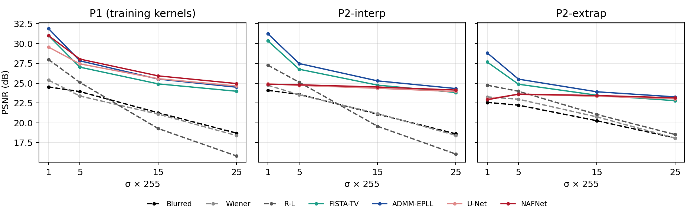

*Figure 1 — Mean test PSNR vs. noise level. M2 in blue/teal, M1 in red/magenta. On $P_1$ NAFNet and ADMM-EPLL nearly coincide; on both $P_2$ sets the M1 curves collapse towards the blurred input at low noise, while the M2 solvers keep their gain.*

### 2.1 In distribution ($P_1$)

NAFNet and ADMM-EPLL are within 0.05 dB of each other on average over $\sigma>0$ (27.48 vs. 27.43 dB), but the ranking depends on the noise level:

- EPLL wins at $\sigma=1/255$ (+0.88 dB on every one of the 200 images).
- NAFNet wins at $\sigma\ge5/255$ by 0.22–0.46 dB, on 97–100% of images.
- FISTA-TV is about 1 dB behind NAFNet at $\sigma\ge5/255$ and tied at $\sigma=1/255$.
- The untuned baselines fare poorly once noise is present on $P_1$: Wiener scores below the blurred input at every $\sigma\ge5/255$, and Richardson–Lucy at $\sigma\ge15/255$.

### Table 2 — Mean test SSIM

Best restored result per row in bold.

| Set | σ | Wiener | R–L | FISTA-TV | ADMM-EPLL | U-Net | NAFNet |
|---|---:|---:|---:|---:|---:|---:|---:|
| $P_1$ | 1 | 0.584 | 0.808 | 0.878 | **0.900** | 0.861 | 0.889 |
| $P_1$ | 5 | 0.492 | 0.599 | 0.754 | 0.790 | 0.785 | **0.802** |
| $P_1$ | 15 | 0.460 | 0.285 | 0.660 | 0.692 | 0.702 | **0.717** |
| $P_1$ | 25 | 0.428 | 0.171 | 0.618 | 0.643 | 0.657 | **0.672** |
| $P_2$-interp | 1 | 0.556 | 0.795 | 0.871 | **0.894** | 0.694 | 0.691 |
| $P_2$-interp | 5 | 0.498 | 0.603 | 0.748 | **0.780** | 0.686 | 0.690 |
| $P_2$-interp | 15 | 0.464 | 0.288 | 0.655 | **0.682** | 0.656 | 0.666 |
| $P_2$-interp | 25 | 0.431 | 0.172 | 0.611 | **0.635** | 0.628 | 0.640 |
| $P_2$-extrap | 1 | 0.475 | 0.672 | 0.777 | **0.820** | 0.593 | 0.589 |
| $P_2$-extrap | 5 | 0.480 | 0.580 | 0.656 | **0.687** | 0.612 | 0.616 |
| $P_2$-extrap | 15 | 0.493 | 0.347 | 0.590 | **0.613** | 0.593 | 0.600 |
| $P_2$-extrap | 25 | 0.482 | 0.226 | 0.558 | **0.582** | 0.574 | 0.583 |

### 2.2 Under kernel mismatch ($P_2$)

ADMM-EPLL is best in every row of both $P_2$ sets. The margin over NAFNet is largest at low noise (+6.4 dB on $P_2$-interp and +5.9 dB on $P_2$-extrap at $\sigma=1/255$) and shrinks to +0.1–0.2 dB at $\sigma=25/255$, where noise rather than blur limits everyone. Every EPLL-vs-NAFNet difference on $P_2$ is significant after Holm correction ($p<10^{-4}$). Even TV, a prior with essentially one parameter, beats both networks on $P_2$ up to $\sigma=15/255$.

### Table 3 — Paired comparisons against NAFNet

Difference = M2 − NAFNet, dB. Unit: image (PSNR averaged over the set’s PSFs), $n=200$. “Win” is the percentage of images where the M2 solver is better; $p$ is the Wilcoxon signed-rank test, Holm-adjusted over 30 tests (the $\sigma=0$ tests are included in the correction but not shown).

**ADMM-EPLL − NAFNet**

| Set | σ | mean | median | win % | $p_{\mathrm{Holm}}$ |
|---|---:|---:|---:|---:|---:|
| $P_1$ | 1 | +0.88 | +0.82 | 100 | $<10^{-4}$ |
| $P_1$ | 5 | −0.22 | −0.19 | 3 | $<10^{-4}$ |
| $P_1$ | 15 | −0.40 | −0.36 | 0 | $<10^{-4}$ |
| $P_1$ | 25 | −0.46 | −0.42 | 0 | $<10^{-4}$ |
| $P_2$-interp | 1 | +6.39 | +6.34 | 100 | $<10^{-4}$ |
| $P_2$-interp | 5 | +2.68 | +2.66 | 100 | $<10^{-4}$ |
| $P_2$-interp | 15 | +0.77 | +0.75 | 100 | $<10^{-4}$ |
| $P_2$-interp | 25 | +0.19 | +0.18 | 82 | $<10^{-4}$ |
| $P_2$-extrap | 1 | +5.93 | +5.79 | 100 | $<10^{-4}$ |
| $P_2$-extrap | 5 | +1.88 | +1.82 | 100 | $<10^{-4}$ |
| $P_2$-extrap | 15 | +0.47 | +0.45 | 99 | $<10^{-4}$ |
| $P_2$-extrap | 25 | +0.12 | +0.13 | 83 | $<10^{-4}$ |

**FISTA-TV − NAFNet**

| Set | σ | mean | median | win % | $p_{\mathrm{Holm}}$ |
|---|---:|---:|---:|---:|---:|
| $P_1$ | 1 | +0.00 | +0.05 | 57 | 0.279 |
| $P_1$ | 5 | −1.02 | −0.93 | 0 | $<10^{-4}$ |
| $P_1$ | 15 | −1.01 | −0.93 | 0 | $<10^{-4}$ |
| $P_1$ | 25 | −0.97 | −0.91 | 0 | $<10^{-4}$ |
| $P_2$-interp | 1 | +5.49 | +5.43 | 100 | $<10^{-4}$ |
| $P_2$-interp | 5 | +1.96 | +1.96 | 100 | $<10^{-4}$ |
| $P_2$-interp | 15 | +0.24 | +0.29 | 78 | $<10^{-4}$ |
| $P_2$-interp | 25 | −0.30 | −0.25 | 2 | $<10^{-4}$ |
| $P_2$-extrap | 1 | +4.77 | +4.69 | 100 | $<10^{-4}$ |
| $P_2$-extrap | 5 | +1.24 | +1.17 | 100 | $<10^{-4}$ |
| $P_2$-extrap | 15 | +0.04 | +0.06 | 64 | 0.0003 |
| $P_2$-extrap | 25 | −0.36 | −0.33 | 0 | $<10^{-4}$ |

---

## 3. Qualitative results

Figure 2 shows restorations for four test cells. To avoid picking favourable examples, each row uses the test image whose ADMM-EPLL − NAFNet PSNR difference is the median over the 200 test images for that cell, and the crop is the $160\times160$ window with the most detail in the sharp image. Nothing was chosen by eye. PSNR is computed on the full image and matches the evaluation files exactly.

| Case | Sharp | Observed | Wiener | FISTA-TV | ADMM-EPLL | NAFNet |
|---|---|---|---|---|---|---|
| **In distribution**<br>$P_1$ motion, 15 px at 45°, σ=5<br>test 181021.jpg |  | 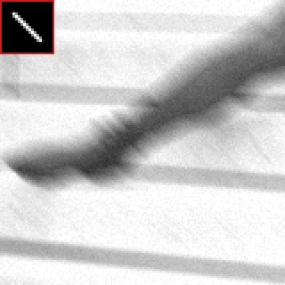<br>19.95 | <br>22.34 | <br>26.24 | 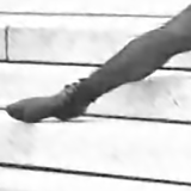<br>28.26 | <br>**28.43** |
| **Unseen motion**<br>$P_2$-interp, 13 px at 67.5°, σ=1<br>test 185092.jpg |  | 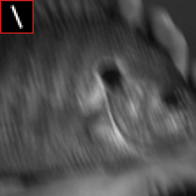<br>27.27 | <br>26.55 | <br>33.42 | 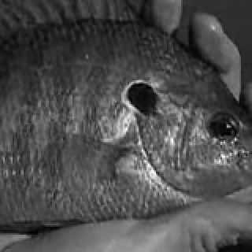<br>**34.23** | <br>26.34 |
| **Unseen family**<br>$P_2$-extrap defocus, radius 7 px, σ=5<br>test 78098.jpg | 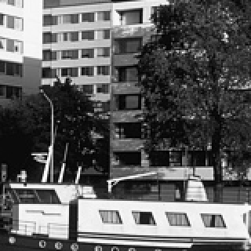 | 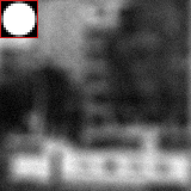<br>17.17 | <br>19.14 | 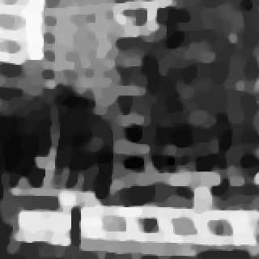<br>19.49 | <br>**20.12** | <br>18.48 |
| **High noise**<br>$P_2$-interp Gaussian $\sigma_k=1.4$, σ=15<br>test 250087.jpg |  | 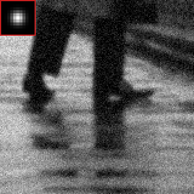<br>23.01 | <br>23.19 | <br>27.72 | 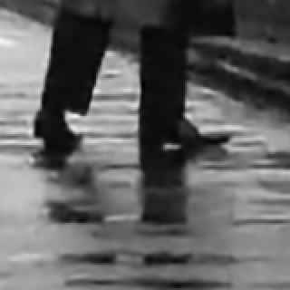<br>28.84 | <br>**29.14** |

*Figure 2 — Restorations on four test cells ($160\times160$ crops; the red-framed inset in the observed image is the blur kernel). Numbers are full-image PSNR (dB); the best restoration per row is in bold. Each image is the median case of its cell for the ADMM-EPLL − NAFNet difference, not a hand-picked example.*

- **In distribution (row 1):** NAFNet and ADMM-EPLL are visually and numerically close. FISTA-TV shows the flat, cartoon-like regions typical of TV, and Wiener leaves visible noise and ringing.
- **Unseen motion direction (row 2):** NAFNet does not undo the 67.5° smear. It adds streaky artifacts instead and scores 0.9 dB below the unrestored observation. Both physics-aware solvers remove the smear and gain 6–7 dB.
- **Unseen defocus (row 3, a hard image with fine texture):** every method struggles. The M2 solvers recover more edge structure, at the cost of some ringing; NAFNet leaves a soft, only partly deblurred result.
- **High noise (row 4):** NAFNet, FISTA-TV and ADMM-EPLL are close, and NAFNet’s output is the cleanest; this is the regime where knowing the kernel matters least.

---

## 4. Kernel mismatch

Table 4 summarises each method’s PSNR averaged over $\sigma>0$ on each set, the change from $P_1$, and the gain over the blurred input. The gain column corrects for the sets being of different difficulty: the blurred input itself is 0.26 dB worse on $P_2$-interp and 1.32 dB worse on $P_2$-extrap.

### Table 4 — Kernel-mismatch summary

Mean over $\sigma\in\{1,5,15,25\}/255$. Δ is the change from $P_1$; “gain” is PSNR minus the blurred input.

| Method | Arm | $P_1$ PSNR | $P_2$-interp PSNR | Δ | $P_2$-extrap PSNR | Δ | Gain $P_1$ | Gain $P_2$-int | Gain $P_2$-ext |
|---|---|---:|---:|---:|---:|---:|---:|---:|---:|
| Blurred input | – | 22.10 | 21.84 | −0.26 | 20.78 | −1.32 | – | – | – |
| Wiener | M2 | 22.06 | 21.96 | −0.10 | 21.26 | −0.80 | −0.04 | +0.12 | +0.48 |
| Richardson–Lucy | M2 | 22.04 | 22.00 | −0.04 | 22.07 | +0.03 | −0.06 | +0.16 | +1.29 |
| FISTA-TV | M2 | 26.73 | 26.42 | −0.31 | 24.70 | −2.03 | +4.63 | +4.58 | +3.92 |
| ADMM-EPLL | M2 | 27.43 | 27.08 | −0.35 | 25.38 | −2.05 | +5.33 | +5.24 | +4.60 |
| U-Net | M1 | 26.80 | 24.48 | −2.32 | 23.24 | −3.56 | +4.70 | +2.64 | +2.45 |
| NAFNet | M1 | 27.48 | 24.57 | −2.91 | 23.28 | −4.20 | +5.38 | +2.73 | +2.49 |

The M2 solvers keep almost all of their gain on unseen kernels: ADMM-EPLL goes from +5.33 dB on $P_1$ to +5.24 dB on $P_2$-interp and +4.60 dB on the unseen defocus family. NAFNet’s gain halves, from +5.38 to +2.73 and +2.49 dB, and U-Net behaves the same way. The two architectures differ by about 0.7 dB on $P_1$ but by less than 0.1 dB on $P_2$: under mismatch, the better architecture does not help.

### 4.1 Where M1 fails

### Table 5 — Mean test PSNR by kernel family (mean over σ > 0)

Best in bold.

| Set | Family | Blurred | Wiener | R–L | FISTA-TV | ADMM-EPLL | U-Net | NAFNet |
|---|---|---:|---:|---:|---:|---:|---:|---:|
| $P_1$ | gaussian | 23.52 | 23.20 | 23.43 | 27.45 | 28.14 | 27.94 | **28.43** |
| $P_1$ | motion | 21.39 | 21.48 | 21.34 | 26.37 | **27.07** | 26.23 | 27.00 |
| $P_2$-interp | gaussian | 23.34 | 23.01 | 23.41 | 27.29 | **27.89** | 27.34 | 27.70 |
| $P_2$-interp | motion | 21.28 | 21.57 | 21.46 | 26.09 | **26.78** | 23.41 | 23.40 |
| $P_2$-extrap | defocus | 20.78 | 21.26 | 22.07 | 24.70 | **25.38** | 23.24 | 23.28 |

On Gaussian kernels NAFNet generalises well: unseen widths cost it 0.7 dB, and it stays within 0.2 dB of EPLL. The failure is on motion blur. Motion kernels at the unseen angles 22.5°, 67.5°, … cost NAFNet 3.6 dB, leaving it only +2.1 dB above the blurred input (23.40 vs. 21.28 dB, while EPLL reaches 26.78 dB). The network learned to undo the eight training motion directions, not motion blur in general. On defocus, which it never saw, NAFNet recovers 2.5 dB, against EPLL’s 4.6 dB.

### 4.2 Data consistency

### Table 6 — Residual $\mathrm{RMSE}(k * \hat{x} - y) \times 255$

For a consistent estimate this is about $\sigma\times255$.

| Set | σ | Wiener | R–L | FISTA-TV | ADMM-EPLL | U-Net | NAFNet |
|---|---:|---:|---:|---:|---:|---:|---:|
| $P_1$ | 1 | 0.93 | 1.21 | 0.87 | 0.85 | 1.52 | 1.13 |
| $P_1$ | 5 | 4.54 | 4.23 | 4.60 | 4.74 | 4.91 | 4.78 |
| $P_1$ | 15 | 18.00 | 12.42 | 14.27 | 14.54 | 14.51 | 14.46 |
| $P_1$ | 25 | 32.65 | 20.66 | 24.13 | 24.08 | 23.98 | 23.97 |
| $P_2$-interp | 1 | 1.05 | 1.26 | 0.90 | 0.88 | 4.13 | 3.92 |
| $P_2$-interp | 5 | 4.70 | 4.40 | 4.68 | 4.80 | 6.34 | 6.10 |
| $P_2$-interp | 15 | 18.27 | 12.87 | 14.38 | 14.62 | 15.01 | 14.94 |
| $P_2$-interp | 25 | 32.95 | 21.26 | 24.19 | 24.16 | 24.30 | 24.28 |
| $P_2$-extrap | 1 | 1.24 | 1.37 | 0.99 | 0.94 | 2.89 | 2.95 |
| $P_2$-extrap | 5 | 5.20 | 4.84 | 4.92 | 4.91 | 5.58 | 5.46 |
| $P_2$-extrap | 15 | 19.46 | 14.13 | 14.71 | 14.73 | 14.95 | 14.90 |
| $P_2$-extrap | 25 | 34.40 | 23.25 | 24.39 | 24.28 | 24.41 | 24.38 |

A restoration consistent with the observation should leave a residual close to the noise level $\sigma$. On $P_1$, FISTA-TV, ADMM-EPLL and both networks are close to it. Under mismatch at low noise, the M1 outputs are inconsistent with the observation: at $\sigma=1/255$ on $P_2$-interp, NAFNet’s residual is 3.9, against 0.9 for FISTA-TV and ADMM-EPLL. In other words, the network returns an image that, re-blurred with the true kernel, does not reproduce what was observed. The M2 solvers enforce this consistency by construction.

---

## 5. Ablations

### 5.1 Does M1 lose because it does not know σ?

M2 is given the true noise level; M1 is not. Table 7 compares the single NAFNet with specialists fine-tuned for one noise level each and evaluated at that level. Knowing σ gains at most 0.25 dB (on $P_1$ at $\sigma=1/255$), essentially nothing elsewhere, and slightly hurts on $P_2$. The noise level is not the missing information. The kernel is, which only physics-aware methods use.

### Table 7 — Per-noise-level oracle

Single NAFNet vs. a specialist fine-tuned at that σ (test PSNR, dB).

| σ | $P_1$ single | $P_1$ spec. | Δ | $P_2$-interp single | $P_2$-interp spec. | Δ | $P_2$-extrap single | $P_2$-extrap spec. | Δ |
|---:|---:|---:|---:|---:|---:|---:|---:|---:|---:|
| 1 | 31.00 | 31.25 | +0.25 | 24.85 | 24.75 | −0.11 | 22.90 | 22.80 | −0.10 |
| 5 | 28.04 | 28.11 | +0.08 | 24.79 | 24.72 | −0.07 | 23.62 | 23.58 | −0.04 |
| 15 | 25.92 | 25.94 | +0.02 | 24.51 | 24.51 | −0.01 | 23.44 | 23.40 | −0.03 |
| 25 | 24.95 | 24.97 | +0.02 | 24.13 | 24.12 | −0.01 | 23.15 | 23.16 | +0.01 |

### 5.2 Prior capacity (GMM K-sweep)

Table 8 and Figure 3 run ADMM-EPLL with GMM priors of $K\in\{1,4,16,64,200\}$ components on a seeded 50-image subset of the test split, all with the λ values tuned for $K=200$.

### Table 8 — ADMM-EPLL with K-component GMM priors

50-image test subset, test PSNR in dB.

| K | $P_1$ σ=1 | $P_1$ σ=5 | $P_1$ σ=15 | $P_1$ σ=25 | Mean $P_1$ | Mean $P_2$-int | Mean $P_2$-ext |
|---:|---:|---:|---:|---:|---:|---:|---:|
| 1 | 28.92 | 25.44 | 23.80 | 23.15 | 25.33 | 25.03 | 23.69 |
| 4 | 31.35 | 27.49 | 25.33 | 24.37 | 27.13 | 26.82 | 25.19 |
| 16 | 31.74 | 27.78 | 25.54 | 24.53 | 27.40 | 27.07 | 25.40 |
| 64 | 31.92 | 27.90 | 25.62 | 24.60 | 27.51 | 27.18 | 25.47 |
| 200 | 31.96 | 27.92 | 25.63 | 24.60 | 27.53 | 27.19 | 25.48 |

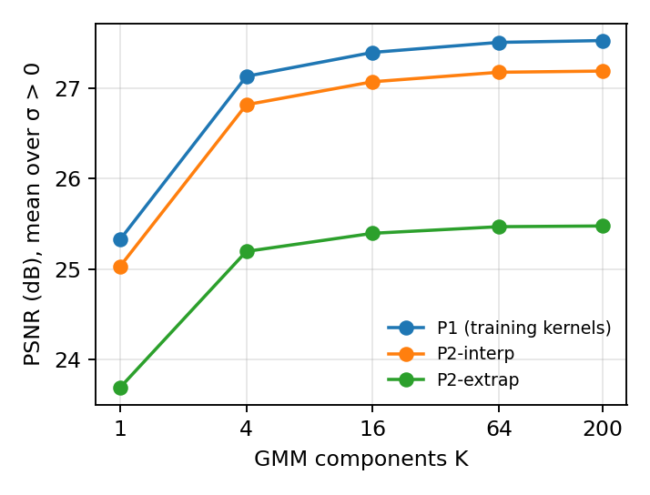

*Figure 3 — ADMM-EPLL test PSNR as a function of prior capacity.*

Capacity helps quickly and then saturates. Going from a single Gaussian ($K=1$, a linear patch prior) to $K=4$ components adds 1.8 dB on $P_1$ (mean over $\sigma>0$); further steps add 0.27 dB (4 → 16), 0.11 dB (16 → 64) and 0.02 dB (64 → 200). The same curve appears on both $P_2$ sets, and the gap between $P_1$ and $P_2$-extrap stays between 1.6 and 2.1 dB for every $K$: a deeper GMM prior improves the M2 solver uniformly but does not change its robustness to kernel mismatch, which comes from the known forward operator. Within the GMM family, $K=200$ is past the point of diminishing returns.

---

## 6. Texture (H2)

**Hypothesis H2:** prior depth matters most on texture. On piecewise-constant content M2 should be competitive, and on natural texture the deep-prior arms should win.

Each test image gets one texture score, the mean gradient magnitude of its sharp luminance image. The 200 test images are split into terciles (edges 0.034 and 0.048). For every method, PSNR is averaged per image over the PSFs of a set and over $\sigma>0$. The paired difference NAFNet − ADMM-EPLL (deep vs. shallow learned prior) is related to texture by Spearman correlation over the 200 images.

### Table 9 — Mean test PSNR (dB) by texture tercile (mean over σ > 0)

| Set | Texture | Blurred | FISTA-TV | ADMM-EPLL | U-Net | NAFNet | NAFNet − EPLL | EPLL − FISTA |
|---|---|---:|---:|---:|---:|---:|---:|---:|
| $P_1$ | low | 23.95 | 29.40 | 30.19 | 29.63 | 30.34 | +0.15 | +0.80 |
|  | medium | 22.11 | 26.65 | 27.33 | 26.71 | 27.38 | +0.05 | +0.68 |
|  | high | 20.22 | 24.10 | 24.72 | 24.02 | 24.67 | -0.04 | +0.62 |
| $P_2$-interp | low | 23.71 | 29.16 | 29.88 | 27.38 | 27.47 | -2.41 | +0.72 |
|  | medium | 21.85 | 26.34 | 26.99 | 24.35 | 24.41 | -2.58 | +0.65 |
|  | high | 19.94 | 23.71 | 24.33 | 21.68 | 21.79 | -2.53 | +0.62 |
| $P_2$-extrap | low | 22.71 | 27.56 | 28.24 | 26.13 | 26.16 | -2.08 | +0.69 |
|  | medium | 20.76 | 24.57 | 25.26 | 23.09 | 23.13 | -2.14 | +0.69 |
|  | high | 18.85 | 21.93 | 22.59 | 20.44 | 20.50 | -2.08 | +0.66 |

| Set | Spearman ρ (texture, NAFNet − EPLL) | p | low vs high tercile, Mann–Whitney p |
|---|---:|---:|---:|
| $P_1$ | -0.545 | 7.7e-17 | 2.2e-12 |
| $P_2$-interp | -0.086 | 0.23 | 0.15 |
| $P_2$-extrap | +0.027 | 0.7 | 0.93 |

- **In distribution, the deep prior's advantage comes from smooth images.** NAFNet leads ADMM-EPLL by 0.15 dB on low-texture images and trails it by 0.04 dB on high-texture ones. The trend is strong and significant (ρ = −0.55, $p\approx10^{-16}$). This is the opposite of H2.
- **The learned GMM's margin over TV also shrinks slightly with texture** (+0.80 → +0.62 dB on $P_1$), again against H2's prediction for the classical prior ladder.
- **Under kernel mismatch, texture plays no role.** The 2.1–2.6 dB deficit of NAFNet is the same in every tercile ($p=0.23$ and $0.7$).

**Verdict:** H2 is not supported for M1 vs. M2. Mean gradient magnitude is a simple texture measure, and M3 (the other deep-prior arm) is not trained, so this is a statement about the arms tested here.

---

## 7. Stability under small perturbations (H3)

**Hypothesis H3:** A-awareness buys stability. M1 should be unstable under tiny perturbations, while the physics-aware arms resist them.

**Protocol (transfer attack).** For each cell, 20 steps of white-box PGD on NAFNet find a perturbation $\eta$ with $\lVert\eta\rVert_2\le\epsilon\lVert y\rVert_2$ that maximises NAFNet's reconstruction error. ADMM-EPLL (tuned λ) then restores the *same* perturbed observation $y+\eta$. Setup: the first 10 test images, every kernel of each set, $\sigma\in\{1,5,15,25\}/255$ and $\epsilon\in\{0.5,1,2\}\%$, giving 3,240 attacked cells. Script: `scripts/stability_test.py`.

### Table 10 — PSNR drop (dB) under the NAFNet-optimised perturbation

“Clean” is the unperturbed PSNR on the same cells. The last column is the share of cells (image × PSF × ε) where ADMM-EPLL loses less than NAFNet.

| Set | σ | NAFNet clean | EPLL clean | NAFNet drop ε=0.5% | ε=1% | ε=2% | EPLL drop ε=0.5% | ε=1% | ε=2% | EPLL drops less (cells) |
|---|---:|---:|---:|---:|---:|---:|---:|---:|---:|---:|
| $P_1$ | 1 | 30.89 | 31.78 | 9.84 | 13.08 | 16.31 | 5.59 | 10.13 | 15.03 | 92% |
| $P_1$ | 5 | 27.99 | 27.81 | 4.11 | 8.55 | 12.48 | 1.34 | 2.82 | 5.89 | 99% |
| $P_1$ | 15 | 25.92 | 25.57 | 1.36 | 3.46 | 7.38 | 0.40 | 0.90 | 2.04 | 100% |
| $P_1$ | 25 | 24.98 | 24.59 | 0.85 | 2.23 | 5.19 | 0.21 | 0.42 | 0.98 | 100% |
| $P_2$-interp | 1 | 25.00 | 31.10 | 5.37 | 7.14 | 9.62 | 3.34 | 8.27 | 14.33 | 38% |
| $P_2$-interp | 5 | 24.94 | 27.46 | 2.99 | 5.63 | 8.83 | 0.42 | 1.27 | 3.25 | 99% |
| $P_2$-interp | 15 | 24.69 | 25.36 | 1.57 | 3.30 | 6.21 | 0.09 | 0.28 | 1.03 | 100% |
| $P_2$-interp | 25 | 24.28 | 24.44 | 0.94 | 2.15 | 4.74 | 0.10 | 0.19 | 0.50 | 100% |
| $P_2$-extrap | 1 | 23.17 | 28.73 | 4.83 | 7.25 | 9.50 | 3.35 | 8.08 | 13.21 | 41% |
| $P_2$-extrap | 5 | 23.93 | 25.59 | 3.03 | 5.27 | 8.16 | 0.24 | 1.30 | 3.42 | 100% |
| $P_2$-extrap | 15 | 23.69 | 24.11 | 1.26 | 2.81 | 5.58 | 0.08 | 0.17 | 0.72 | 100% |
| $P_2$-extrap | 25 | 23.37 | 23.51 | 0.78 | 1.78 | 4.12 | 0.10 | 0.18 | 0.38 | 100% |

Perturbation size (mean RMS, /255 units): ε=0.5% → 0.64, ε=1% → 1.27, ε=2% → 2.51.

- **At σ ≥ 5/255, H3 holds clearly.** ADMM-EPLL loses 2–17 times less PSNR than NAFNet under the same perturbation (e.g. 0.28 vs. 3.30 dB on $P_2$-interp at σ = 15, ε = 1%), and loses less in 99–100% of cells.
- **At σ = 1/255 it does not.** The smallest perturbation (0.64/255 RMS) is already comparable to the noise, and ADMM-EPLL's λ for σ = 1 was tuned for almost no regularisation, so it amplifies the perturbation. This is the same mechanism as the σ = 0 inverse crime (Section 9). On $P_2$, ADMM-EPLL loses *more* than NAFNet in about 60% of cells, up to 14.3 vs. 9.6 dB at ε = 2%.
- **In absolute terms ADMM-EPLL stays ahead everywhere.** Its PSNR after the attack is higher than NAFNet's after the attack in every row, by 0.25 to 8.1 dB.
- **Caveat.** This is a transfer attack: η is NAFNet's worst case, not ADMM-EPLL's. A white-box attack on M2 needs a differentiable FISTA/EPLL and is future work. The result shows that NAFNet's adversarial directions do not carry over to the physics-aware solver; it is not a worst-case bound for M2.

**Verdict:** H3 is supported for σ ≥ 5/255 under a transfer attack, and fails at σ = 1/255.

---

## 8. Perceptual quality (LPIPS)

LPIPS (lower is better) on the seeded 50-image test subset used for the $K$-sweep, $\sigma>0$, every kernel of each set. Best per row in bold.

### Table 11 — Mean LPIPS

<!-- lpips:start -->
| Set | σ | Wiener | R–L | FISTA-TV | ADMM-EPLL | U-Net | NAFNet |
|---|---:|---:|---:|---:|---:|---:|---:|
| $P_1$ | 1 | 0.396 | 0.266 | 0.115 | 0.109 | 0.117 | **0.094** |
| $P_1$ | 5 | 0.560 | 0.450 | 0.249 | 0.267 | 0.221 | **0.208** |
| $P_1$ | 15 | 0.601 | 0.735 | 0.348 | 0.399 | 0.323 | **0.315** |
| $P_1$ | 25 | 0.633 | 0.873 | 0.394 | 0.467 | 0.370 | **0.367** |
| $P_2$-interp | 1 | 0.439 | 0.285 | 0.122 | **0.116** | 0.280 | 0.305 |
| $P_2$-interp | 5 | 0.555 | 0.447 | **0.252** | 0.282 | 0.330 | 0.346 |
| $P_2$-interp | 15 | 0.589 | 0.696 | **0.352** | 0.414 | 0.382 | 0.396 |
| $P_2$-interp | 25 | 0.619 | 0.833 | **0.399** | 0.480 | 0.409 | 0.425 |
| $P_2$-extrap | 1 | 0.551 | 0.452 | **0.215** | 0.215 | 0.430 | 0.429 |
| $P_2$-extrap | 5 | 0.571 | 0.483 | **0.342** | 0.425 | 0.480 | 0.510 |
| $P_2$-extrap | 15 | 0.593 | 0.585 | **0.424** | 0.549 | 0.500 | 0.544 |
| $P_2$-extrap | 25 | 0.617 | 0.647 | **0.477** | 0.600 | 0.507 | 0.544 |
| $P_1$ | **mean σ>0** | 0.547 | 0.581 | 0.276 | 0.310 | 0.258 | **0.246** |
| $P_2$-interp | **mean σ>0** | 0.551 | 0.565 | **0.281** | 0.323 | 0.350 | 0.368 |
| $P_2$-extrap | **mean σ>0** | 0.583 | 0.542 | **0.364** | 0.447 | 0.479 | 0.507 |
<!-- lpips:end -->

- **In distribution, the networks are perceptually better than PSNR suggests.** On $P_1$, ADMM-EPLL and NAFNet are tied in PSNR, but NAFNet's LPIPS is 0.246 against 0.310. NAFNet is best at every noise level on $P_1$.
- **Under mismatch, the physics-aware solvers win perceptually, and FISTA-TV is best.** FISTA-TV has the lowest LPIPS in every $P_2$ row except $P_2$-interp at σ = 1, where ADMM-EPLL is ahead by 0.006 (on $P_2$-extrap at σ = 1 the two tie at 0.215). Averaged over σ > 0, FISTA-TV scores 0.281 on $P_2$-interp and 0.364 on $P_2$-extrap, against 0.368 and 0.507 for NAFNet.
- **PSNR and LPIPS rank the two M2 solvers differently.** ADMM-EPLL beats FISTA-TV by 0.4–1.2 dB in PSNR in every row of Table 1, but FISTA-TV has the better LPIPS at every σ ≥ 5/255, on $P_1$ as well. A likely reason: the EPLL estimate averages many overlapping patch reconstructions, which lowers the squared error but smooths fine detail, while TV keeps sharp edges, which LPIPS rewards. The gap is largest at high noise (e.g. 0.477 vs. 0.600 on $P_2$-extrap at σ = 25).
- **U-Net is perceptually slightly better than NAFNet under mismatch** (0.350 vs. 0.368 on $P_2$-interp), although NAFNet is better on $P_1$.

---

## 9. The noiseless case is an inverse crime

At $\sigma=0$ the test observations are produced with exactly the circular FFT operator that the M2 solvers invert, with no noise and no quantization. Wiener deconvolution then inverts the blur almost exactly, scoring 80–100 dB, and the other M2 solvers are inflated as well. Such numbers say nothing about real deblurring.

As a check we rounded the $\sigma=0$ observations to 8-bit levels, an error of about 0.0011 RMS. Wiener collapses to 5–13 dB, far below the blurred input, because it amplifies the quantization error without limit. ADMM-EPLL, whose $\sigma=0$ weight was tuned to almost no regularisation, loses 6–9 dB. The networks and Richardson–Lucy are essentially unaffected. Even on quantized data, though, ADMM-EPLL and FISTA-TV stay well ahead of NAFNet on $P_2$ (e.g. 32.0 and 32.5 vs. 24.8 dB on $P_2$-interp).

We therefore exclude $\sigma=0$ from every average in this report and do not use it for any M1-vs-M2 claim. In future, observations should be quantized, or a noise floor added, as part of the protocol.

### Table 12 — σ = 0: exact observations vs. 8-bit quantized

Test PSNR (dB). The λ values tuned for $\sigma=0$ are kept.

| Method | $P_1$ exact | $P_1$ 8-bit | $P_2$-interp exact | $P_2$-interp 8-bit | $P_2$-extrap exact | $P_2$-extrap 8-bit |
|---|---:|---:|---:|---:|---:|---:|
| Blurred input | 24.55 | 24.55 | 24.11 | 24.11 | 22.59 | 22.59 |
| Wiener | 100.49 | 12.59 | 82.70 | 6.66 | 80.31 | 5.41 |
| Richardson–Lucy | 28.44 | 28.38 | 27.43 | 27.41 | 24.78 | 24.78 |
| FISTA-TV | 34.22 | 33.52 | 33.03 | 32.51 | 29.96 | 29.62 |
| ADMM-EPLL | 41.00 | 33.58 | 38.89 | 32.04 | 36.09 | 27.30 |
| U-Net | 30.29 | 30.17 | 25.05 | 25.01 | 22.70 | 22.73 |
| NAFNet | 32.61 | 32.09 | 24.90 | 24.79 | 22.72 | 22.71 |

---

## 10. Discussion

1. **In distribution, a 17 M-parameter network and a 200-component GMM with five tuned scalars are on par.** NAFNet’s advantage on $P_1$ is at most 0.5 dB and appears only at moderate-to-high noise. The learned prior (EPLL) is worth about 0.7 dB over the hand-crafted one (TV).
2. **Physics-awareness is what transfers.** Under kernel mismatch the M1 networks lose half their gain, and on unseen motion directions nearly all of it, while the M2 solvers barely degrade. The per-σ oracle and the residual analysis both point to the unknown kernel, not the unknown noise level, as the cause.
3. **Architecture matters only in distribution.** NAFNet beats U-Net by 0.7 dB on $P_1$ and by less than 0.1 dB on $P_2$.
4. **The gap closes with noise.** At $\sigma=25/255$ all good methods lie within about 1 dB on every set: the problem is noise-limited, and knowing the kernel helps less.
5. **The metric changes the ranking, but not the mismatch conclusion.** Perceptually (LPIPS) the networks win clearly on the training kernels, where PSNR calls a tie. Under kernel mismatch the physics-aware solvers win by both metrics: ADMM-EPLL by PSNR, FISTA-TV by LPIPS.
6. **Physics-awareness buys stability only when the noise model leaves room for it.** At σ ≥ 5/255, NAFNet's adversarial perturbations barely affect ADMM-EPLL; at σ = 1/255 the weakly regularised solver amplifies them.

### Hypothesis scorecard (M1 vs. M2; M3 pending)

| Hypothesis | Prediction | Result |
|---|---|---|
| **H1** — physics-awareness pays off as information degrades | Gap widens with kernel mismatch | **Supported**: EPLL goes from tied to +2–6 dB (Sections 2, 4) |
| | Gap widens with noise | **Not supported**: EPLL's advantage shrinks as noise grows (Table 1) |
| | Gap widens with texture | **Weakly supported in distribution** (NAFNet's lead vanishes on textured images), no effect under mismatch (Section 6) |
| **H2** — prior depth matters most on texture | Deep prior wins on texture | **Not supported**: NAFNet's lead comes from smooth images (Section 6) |
| **H3** — A-awareness buys stability | M2 resists perturbations that break M1 | **Supported at σ ≥ 5/255** (2–17× smaller drop), **fails at σ = 1/255**; transfer attack only (Section 7) |

### Fairness and limitations

- **M2 is given the true $k$ and $\sigma$** (non-blind), and its $\lambda$ is tuned per noise level on val. This is the intended contrast between the arms, not a confound. A blind or estimated-kernel M2 is not evaluated.
- **M3 (unrolled, physics-aware networks) is not yet trained.** It is needed to separate physics-awareness from prior depth.
- **H3 is a transfer attack** on 10 test images; a white-box attack on M2 itself is not evaluated.
- The noise model is synthetic Gaussian with circular boundaries; real blur (GoPro) is not evaluated.
- Each model was trained once (one seed); differences of a few tenths of a dB between M1 variants should be read with that in mind.
- LPIPS is reported on a 50-image test subset, not the full test split.
- The texture analysis (H2) uses a single texture measure (mean gradient magnitude).
- The K-sweep reuses the λ tuned for $K=200$ and runs on 50 images. For ADMM-EPLL at $\sigma=0$, the best λ lay at the edge of the search grid (an inverse-crime effect, Section 9).

---

## 11. Reproducibility and status

### Code and data

| Item | Location |
|---|---|
| M1 training | `scripts/train_m1.py` |
| M1 evaluation | `scripts/eval_m1.py`, `scripts/evaluate.py` |
| EPLL/GMM prior | `scripts/train_gmm.py` |
| M3 training (USRNet / ISTA-Net / LISTA) | `scripts/train_m3.py`, `src/deblur/methods/unrolled/` |
| Unified evaluation | `scripts/evaluate.py` (M2 GPU backend: `--m2-backend torch`) |
| H3 stability (transfer attack) | `scripts/stability_test.py`, `src/deblur/metrics/stability.py` |
| Tables and statistics | `scripts/analyze_m1_m2.py` |
| Texture analysis (H2) | `scripts/analyze_texture.py` → `report/generated/texture.md` |
| H3 and LPIPS tables | `scripts/analyze_h3_lpips.py` → `report/generated/h3.md`, `lpips.md` |
| Qualitative figure | `scripts/make_qualitative.py` |
| Aggregated results | `report/generated/numbers.json`, `psnr_P1.dat`, `psnr_P2_interp.dat`, `psnr_P2_extrap.dat`, `ksweep.dat` |
| Qualitative crops | `report/generated/qualitative/` |
| Figures | `report/generated/figure1_psnr_vs_sigma.png`, `report/generated/figure3_ksweep.png` |

The H3 run used, once per PSF set (`P1`, `P2_interp`, `P2_extrap`):

```bash
python3 scripts/stability_test.py --data-root data \
  --gmm checkpoints/m2/gmm_K200.npz \
  --lambda-values <the five tuned ADMM-EPLL values> \
  --psf-set P1 --psf-limit 100 --sigmas 1,5,15,25 \
  --eps 0.005,0.01,0.02 --limit 10
```

LPIPS used `scripts/evaluate.py ... --subset 50 --sigmas 1,5,15,25 --lpips` for every method.

Protocol manifests (PSF sets, splits, validation subset) are git-ignored; regenerate them with:

```bash
python3 scripts/setup_datasets.py --datasets bsds500 --write-protocol
```

The raw per-cell evaluation CSVs and the `sigma0_quantized` CSVs used by `scripts/analyze_m1_m2.py` are not included in this snapshot; rerun `scripts/evaluate.py` (and the 8-bit σ=0 pass) to regenerate them.

### Status

- **M1 + M2:** complete interim comparison, reported above.
- **M3:** implemented, not trained; the three-arm control is pending.
- **H2:** texture analysis done (Section 6); not supported.
- **H3:** transfer attack run on all three PSF sets (Section 7); supported at σ ≥ 5/255.
- **LPIPS:** all methods on the 50-image test subset (Section 8).
- **σ=0:** excluded from headline averages; 8-bit check reported. Future runs should quantize observations or add a noise floor to the protocol.

---

*Data: `report/generated/numbers.json` · Report source: this Markdown file.*
